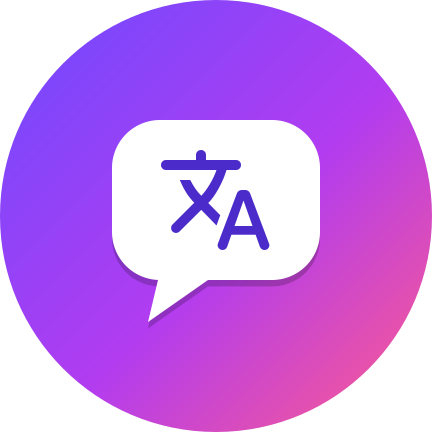

<div align="center">



# Mangalate

Leitor de mangá para Android, baseado no [Mihon](https://github.com/mihonapp/mihon), que **traduz as páginas** e escreve a tradução dentro dos próprios balões.

[Baixar](https://github.com/delkrusty/Mangalate/releases/latest) · [Ajuda](HELP.md) · [Servidor + IA](server/README.md) · [Novidades](CHANGELOG.md)

</div>

## Começar

1. Baixe `Mangalate-arm64-v8a.apk` em [Releases](https://github.com/delkrusty/Mangalate/releases/latest). Se não instalar, use `Mangalate-universal.apk`.
2. Abra um capítulo e toque em **文A** na barra do leitor.
3. Escolha os idiomas e toque em **Traduzir**. Para ver o original, toque em 文A de novo.

O app não traz fontes de conteúdo: as extensões são instaladas por você, como no Mihon.

## Dois modos

| | **No celular** (padrão) | **Servidor + IA** |
|---|---|---|
| Onde roda | No celular, offline | No seu PC, com Docker |
| Tradução | Google ML Kit | Uma IA grátis escolhida por você (Groq, Gemini, OpenRouter ou Ollama) |
| Qualidade | Boa para entender a história | Português natural, com nomes e tom dos personagens |

O servidor tem [manual próprio](server/README.md). Só o texto das falas vai para a IA, nunca as imagens, e a chave da IA fica no seu PC.

Para ler offline, ligue **Traduzir capítulos ao baixar** em Mais › Tradução (Mangalate).

## Limitações

- Letra muito estilizada, japonês vertical e balão aberto podem sair errados ou ficar no original.
- Com "Preservar a arte" ligado (o padrão), parte do texto sobre o desenho fica no original, e a página é marcada para revisão.
- No servidor, a placa de vídeo acelera só com NVIDIA. AMD é experimental.

## Desenvolvimento

```bash
./gradlew :app:assembleRelease -Pdist=local
python -m unittest discover -s server/tests
```

## Créditos e licença

Base: [Mihon](https://github.com/mihonapp/mihon) (Apache 2.0). Servidor: [manga-image-translator](https://github.com/zyddnys/manga-image-translator) (GPL-3.0), rodando como serviço separado. Tradução no celular: Google ML Kit. Fonte Comic Neue (SIL OFL 1.1), ícones Material Symbols (Apache 2.0) e divisão silábica [DivSilab/LibreOffice](https://github.com/LibreOffice/dictionaries/tree/master/pt_BR) (MPL).

O app usa a licença Apache 2.0 ([LICENSE](LICENSE)). `server/engine_compat.py` é GPL-3.0, como o motor que adapta ([LICENSE.engine](server/LICENSE.engine)). Os modelos baixados têm licenças próprias.
