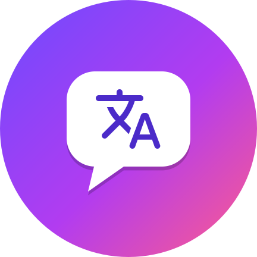

<div align="center">



# Mangalate

Leitor de mangá para Android, baseado no [Mihon](https://github.com/mihonapp/mihon), que **traduz as páginas** e escreve a tradução dentro dos próprios balões.

[Baixar](https://github.com/delkrusty/Mangalate/releases/latest) · [Ajuda](HELP.md) · [Servidor + IA](server/README.md) · [Novidades](CHANGELOG.md)

</div>

## Começar

1. Baixe o APK em [Releases](https://github.com/delkrusty/Mangalate/releases/latest). `Mangalate-arm64-v8a.apk` serve na maioria dos celulares; se não instalar, use `Mangalate-universal.apk`.
2. Abra um capítulo e toque em **文A** na barra do leitor.
3. Escolha o idioma do mangá e o idioma da tradução e toque em **Traduzir**.

Para voltar ao original, toque em 文A de novo. O app não traz fontes de conteúdo: as extensões são instaladas por você, como no Mihon.

## Dois modos

| | **No celular** (padrão) | **Servidor + IA** |
|---|---|---|
| Onde roda | No próprio celular, offline | No seu PC, com Docker |
| Tradução | Google ML Kit | IA escolhida por você: Groq e Gemini (grátis, se revezando entre as páginas), OpenRouter ou Ollama no PC |
| Qualidade | Boa para entender a história | Português natural, nomes e tom dos personagens respeitados |
| Precisa de | Baixar os idiomas uma vez | PC ligado, Docker e uma chave grátis de IA |

Para usar o servidor, siga o [manual do servidor](server/README.md); a escolha da IA está no [guia de IAs](server/BYOK.md). Só o texto das falas vai para a IA, nunca as imagens. A chave da IA fica no seu PC, e o Mangalate não cobra nada.

## Ler offline

- **Pré-tradução:** enquanto você lê, as páginas seguintes já vão sendo traduzidas.
- **Traduzir ao baixar:** ligue em Mais › Tradução (Mangalate). Os capítulos baixados chegam traduzidos e podem ser lidos sem internet.
- Mudar idioma, modo ou servidor pode exigir traduzir de novo. Prepare os capítulos antes de sair.

## Limitações

- Letras muito estilizadas, japonês vertical, balões abertos e texto sobre o desenho podem sair errados ou ficar no original. Confira o resultado antes de compartilhar.
- O servidor deixa no original o texto que está sobre a arte, em vez de apagar o desenho, e marca essas páginas para revisão.
- Aceleração por placa de vídeo no servidor: NVIDIA (CUDA). AMD é experimental: Radeon RX 7000 ou mais nova no Windows (pelo WSL2) ou ROCm no Linux; nos demais casos, o servidor usa a CPU.
- Com a tradução ligada, o renderizador experimental do Mihon é trocado pelo leitor clássico.

## Compilar

O GitHub Actions compila a cada push. Localmente, com JDK 21 e Android SDK:

```bash
./gradlew :app:assembleRelease -Pdist=local
```

Os testes do servidor estão em `server/tests` (`python -m unittest discover server/tests`).

## Créditos e licença

- Base: [Mihon](https://github.com/mihonapp/mihon) (Apache 2.0).
- Tradução no celular: Google ML Kit. Fonte Comic Neue (SIL OFL 1.1). Ícones Material Symbols (Apache 2.0).
- Servidor: [manga-image-translator](https://github.com/zyddnys/manga-image-translator) (GPL-3.0), rodando como serviço separado.
- Divisão silábica: [DivSilab/LibreOffice](https://github.com/LibreOffice/dictionaries/tree/master/pt_BR), de Raimundo Santos Moura (MPL), sem modificações, em `app/src/main/assets/lettering/`.

O aplicativo usa a licença Apache 2.0 ([LICENSE](LICENSE)). A adaptação `server/engine_compat.py` é GPL-3.0, como o motor que ela adapta; a licença do motor fica em [server/LICENSE.engine](server/LICENSE.engine) e dentro das imagens Docker. Os modelos baixados têm licenças próprias.
